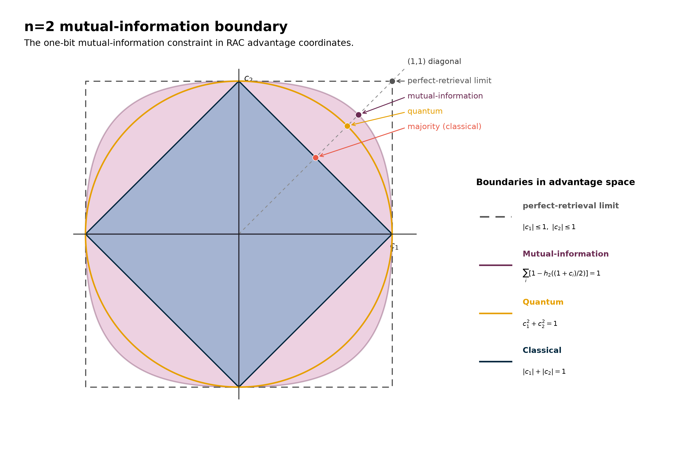
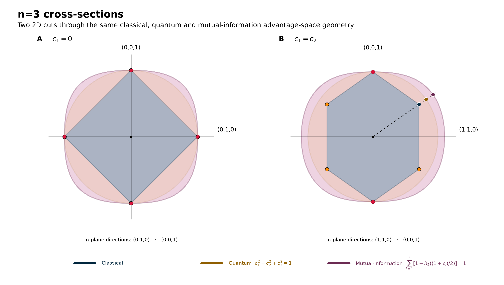
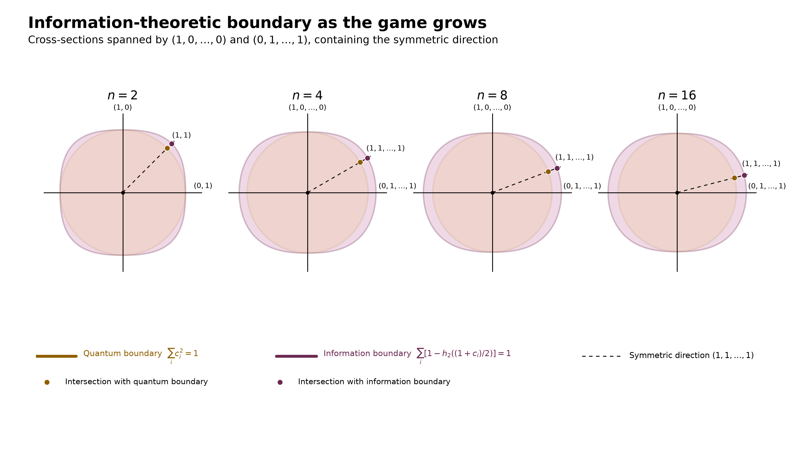

# Why Isn’t Nature More Quantum?

### *Quantum physics draws a boundary. Information theory approaches the same limit from a completely different direction.*

Alice and Bob are playing a simple guessing game: QSeaBattle. Alice sees a board containing *n* bits and may send Bob one bit, while Bob is asked about one randomly chosen position. His job is simple: guess whether the bit at that position is 0 or 1.

We discussed this game in previous posts and ended with a surprisingly simple result. The **classical strategy** became more and more complicated as we increased the number of bits, but **quantum mechanics** did the opposite: it replaced that many-faced geometry with a sphere. For two bits we had a circle, for three a sphere, and in general a hypersphere,

*c₁*² + *c₂*² + ⋯ + *cₙ*² = 1.

This boundary comes from physics. Behind it sits the mathematical structure of quantum mechanics: Hilbert space, operators representing observables, and the Born rule that turns quantum amplitudes into probabilities. Almost exactly a century ago, the probabilistic interpretation of the new quantum mechanics established the rules from which this quantum limit ultimately follows. Famously, Born's 1926 scattering paper initially stated the probability interpretation incorrectly and corrected it in proof: it was the square of the amplitude that mattered.

So quantum mechanics tells us where Nature stops. But that is not quite the same as understanding why it stops there.

Let us ignore quantum mechanics for a moment and imagine that, in this game, Bob can correctly guess whichever of Alice’s two bits he is asked for, with 100% certainty. In our geometry, such a resource would take us all the way to the corner *c₁* = *c₂* = 1.

That sounds as if we must be violating some fundamental principle. Perhaps it would require instantaneous communication, violating Einstein’s prohibition on faster-than-light communication?

It does not. It is possible to construct hypothetical correlations that give Bob this extraordinary ability while still preventing Alice from sending him any information faster than light [1].

So we have a strange situation. Geometry allows it. Causality allows it. Yet Nature apparently does not.

What, then, is wrong with Bob being able to know whichever bit he chooses?

Perhaps the problem is not causality, but information. Alice sent only one bit. Should Bob really be able to use that one bit, together with his shared resource, to recover either of two independent bits perfectly?

This suggests a different way of looking at the quantum boundary. Instead of starting from quantum physics and asking what correlations it permits, can we start from information and recover the same restriction?

> **Can an information-theoretical principle explain why Nature stops at the quantum boundary?**

## The Information Boundary

Now evaluate the same game from an **information** perspective.

For each possible question, Bob's advantage *cᵢ* corresponds to a success probability

*Pᵢ* = ½(1 + *cᵢ*).

From that probability we can calculate how much information Bob's answer carries about Alice's bit. For a uniformly random bit this is

*Iᵢ* = 1 − *h₂(Pᵢ*),

where *h₂* is the binary entropy.

Alice sends Bob only one classical bit. Pawłowski and colleagues proposed that this should impose a deeper restriction: however Alice and Bob exploit their shared resources, the total information available through Bob's possible retrieval choices should not exceed the information Alice actually communicates [2]. For our game,

Σᵢ *Iᵢ* ≤ 1.

They called this proposed physical principle **Information Causality**.

Information Causality adds the information associated with all Bob's possible retrieval choices. Importantly, Bob does not actually make all those choices: in any one run he chooses one question and obtains one answer (in fact, once he uses his quantum resource for one measurement, he can't go back and ask what he'd have learned from another). We will return to what it means to add the information associated with these alternative possibilities.

The proposal is stronger than merely using the inequality as a convenient mathematical bound. The suggestion is that Nature itself respects this information budget. So let us take the principle seriously and see what boundary it draws.

> *Figure 1: Classical, quantum, Information Causality and perfect-retrieval boundaries for the two-bit guessing game. Classical one-bit strategies form the inner diamond, while quantum strategies reach the circle. The information boundary extends beyond the quantum circle in most directions. Farther out, the dashed square marks the perfect-retrieval limit, where both retrieval advantages can in principle reach ±1. Image by author.*
>
> Alt text: Two-dimensional RAC advantage-space diagram with four nested regions. A classical diamond lies inside the quantum circle. A larger rounded information boundary extends beyond the circle, while an outer dashed square marks the perfect-retrieval limit at |c₁| ≤ 1 and |c₂| ≤ 1. Along the positive diagonal, classical majority, quantum and information-boundary points are marked.

Figure 1 combines the two perspectives in a single picture. The circle is the boundary supplied by quantum physics. The rounded shape outside it is the boundary supplied by the information principle.

They are not the same.

For two bits, Information Causality is more permissive than quantum mechanics. Along the diagonal there is visible room between the quantum point and the point where the information budget is exhausted. So if Information Causality is going to tell us something about why Nature selects the quantum limit, the answer is not simply that its finite-game boundary reproduces the quantum circle.

Perhaps two bits are simply too few.

## As the Game Gets Bigger

With three bits we get one last chance to see the complete geometry before it escapes into higher dimensions.

> *Figure 2: The same comparison in the full n = 3 advantage space. The classical strategies form a faceted polytope, the quantum boundary is a sphere, and Information Causality defines a larger, distinctly non-spherical body. Image by author*
>
> Alt text: Three-dimensional RAC advantage-space rendering for n = 3. A faceted classical polytope sits inside a translucent quantum sphere, while a larger rounded Information Causality surface surrounds the quantum boundary in most directions. The three advantage axes c₁, c₂ and c₃ are shown.

Figure 2 shows the full three-dimensional advantage space. Figure 3 shows two cross-sections through it. The sphere becomes a circle in each cut, while the information boundary produces a different, somewhat larger curve. Just as for two bits, information theory still leaves room outside the quantum boundary.

> *Figure 3: Two cross-sections through the three-dimensional advantage space for n = 3. The classical polytope, quantum sphere and information boundary produce visibly different shapes. In particular, the information boundary still leaves room beyond the quantum sphere. Image by author.*
>
> Alt text: Two two-dimensional cross-sections through the n = 3 advantage space, comparing the classical polytope, the circular cross-section of the quantum sphere and the larger information boundary.

For four bits the full advantage space is already four-dimensional, so we can no longer draw it. But the cross-sections give us a way forward. We can take equivalent two-dimensional cuts through higher-dimensional shapes and watch what happens as the game grows.

There is one direction that is particularly useful: the symmetric direction *(1,1,…,1)*, where Bob has the same advantage for every possible question. On the quantum sphere, if every coordinate has the same value *c*, then

*n c²* = 1,

so the quantum boundary lies at

*c* = 1/√*n*.

As the game grows, the quantum advantage available for each individual question therefore shrinks: 1/√2 for two bits, 1/2 for four, 1/√8 for eight, and so on.

Now compare that known quantum boundary with the information boundary obtained from the one-bit budget. The information boundary converges to a shape that touches the quantum boundary at the (1,0,0,…) axis and bulges out in the uniform (1,1,1,…) direction. The two shapes do not converge: for every *n*, Information Causality still allows some points beyond the quantum sphere.

> *Figure 4: Quantum and information boundaries as the guessing game grows. Each panel shows a cross-section containing one coordinate axis and the symmetric (1,1,…,1) direction. The quantum boundary remains a circle, while the information boundary approaches a stable non-spherical shape. Along the symmetric direction their radial separation remains finite, but that radius is distributed over more coordinates as n grows, so the advantage per individual question scales as 1/√n. Image by author.*
>
> Alt text: Four equivalent two-dimensional cross-sections for n = 2, 4, 8 and 16. Each compares the circular quantum boundary with the larger information boundary. The vertical direction represents advantage concentrated in one question, while the horizontal direction distributes advantage equally over all remaining questions. The information boundary increasingly approaches a stable rounded shape outside the quantum circle. The dashed symmetric direction rotates toward the horizontal axis as n increases; marked points show where it crosses the quantum and information boundaries.

Why do larger games become sensitive? Along the symmetric direction, both boundaries sit at a radius that barely moves as *n* grows: the quantum radius stays exactly 1, the information radius approaches about √(2 ln 2) ≈ 1.177. So in absolute terms the two stay roughly the same distance apart, however large the game gets. But that fixed gap is shared out over more and more bits as *n* grows — so the amount of extra advantage allowed per bit keeps shrinking. A correlation only slightly stronger than the quantum one can look harmless when there are just two bits to spread it over, yet when that same slight excess is repeatedly used to construct larger games, its advantage eventually carries us across the information boundary. In the familiar language of analysis: **for every ε > 0, there exists an *n* for which information theory objects if we take the strength of the correlation to exceed the highest quantum value by ε.**

This is the key result of Information Causality. Pawłowski and colleagues showed that even an arbitrarily small excess in the underlying correlation beyond the quantum limit eventually violates the one-bit information budget [2]. The information boundary never literally becomes the finite-n quantum sphere, yet the strongest correlation that survives this test for arbitrarily large games is precisely the quantum one.

> **Go even slightly beyond the quantum limit, and eventually there is a guessing game large enough for information theory to object.**

## Why Isn’t Nature More Quantum?

We have arrived at the same limiting correlation strength by two very different roads.

The first road began with physics. The mathematical structure developed in the first years of quantum mechanics became the modern framework of Hilbert spaces, operators and probabilities. Within that framework, quantum mechanics determines how far Alice and Bob can go.

The second road did not assume quantum mechanics. We started with a guessing game, one communicated bit and a proposed principle about information. At any finite game size that principle is actually more permissive than quantum mechanics. Yet when Pawłowski and colleagues ask which correlations can survive the information test for arbitrarily large games, the same quantum limit reappears.

That coincidence is the remarkable part.

Perhaps Information Causality is telling us *why* Nature is not more quantum: correlations stronger than the quantum limit would eventually allow Alice and Bob to violate a fundamental information budget.

But does that close the story? Not completely.

The first thing to wonder about is the information sum itself. Bob never retrieves all *n* bits. He is asked for one bit, chooses the corresponding measurement, and obtains one answer. In the quantum case, that choice matters: once he has used his shared quantum resource, he cannot go back and ask what he would have learned had he chosen another measurement instead.

Information Causality nevertheless adds the mutual informations associated with all these alternative choices. In a sense, it puts all the things Bob *could* have learned into one information budget, even though he *never can* learn them simultaneously. Should we interpret this sum as the amount of information Bob actually has — or as a measure of what he could have learned under mutually exclusive choices?

There is also something peculiar about this limit. In advantage space, the quantum boundary remains a hypersphere of radius one. Along the symmetric direction the information boundary approaches radius √(2 ln 2) (≈1.177, as we saw). When *n* grows the advantage as well as the difference is distributed over more and more indices, making the value for each index approach zero. We distinguish quantum mechanics from a slightly stronger theory in a curious limit: Bob faces more and more possible questions, while his chance of correctly answering any particular one gets closer and closer to a random guess.

None of this makes Information Causality less remarkable. One route begins with the physical and mathematical structure of quantum mechanics. The other begins with a proposed principle about information. Yet both single out the same limiting correlation strength.

The question is what we should make of that coincidence.

Information Causality is not the only attempt to understand why Nature stops where it does. Communication-complexity arguments [3,4] and principles such as Macroscopic Locality [5] constrain the post-quantum world from different directions.

Perhaps information really is the fundamental principle hiding behind the quantum boundary. Or perhaps Information Causality is seeing the shadow of something deeper — a principle of geometry, consistency or symmetry that we have not yet identified.

So, after starting with a simple guessing game, we have arrived at a question that is still very much alive:

**Why isn't Nature more quantum?**

> **Does Information Causality explain the quantum boundary — or merely find the same limit from another direction?**

## References
[1] S. Popescu and D. Rohrlich, "Quantum Nonlocality as an Axiom," *Foundations of Physics* **24**, 379–385 (1994). https://doi.org/10.1007/BF02058098

[2] M. Pawłowski, T. Paterek, D. Kaszlikowski, V. Scarani, A. Winter and M. Żukowski, “Information Causality as a Physical Principle,” *Nature* **461**, 1101–1104 (2009). https://doi.org/10.1038/nature08400

[3] W. van Dam, “Implausible Consequences of Superstrong Nonlocality,” *Natural Computing* **12**, 9–12 (2013); originally arXiv:quant-ph/0501159 (2005).

[4] G. Brassard, H. Buhrman, N. Linden, A. A. Méthot, A. Tapp and F. Unger, “Limit on Nonlocality in Any World in Which Communication Complexity Is Not Trivial,” *Physical Review Letters* **96**, 250401 (2006). https://doi.org/10.1103/PhysRevLett.96.250401

[5] M. Navascués and H. Wunderlich, “A Glance Beyond the Quantum Model,” *Proceedings of the Royal Society A* **466**, 881–890 (2010). https://doi.org/10.1098/rspa.2009.0453

> *[QSeaBattle is on Github](https://robhendrik.github.io/QSeaBattle/)*