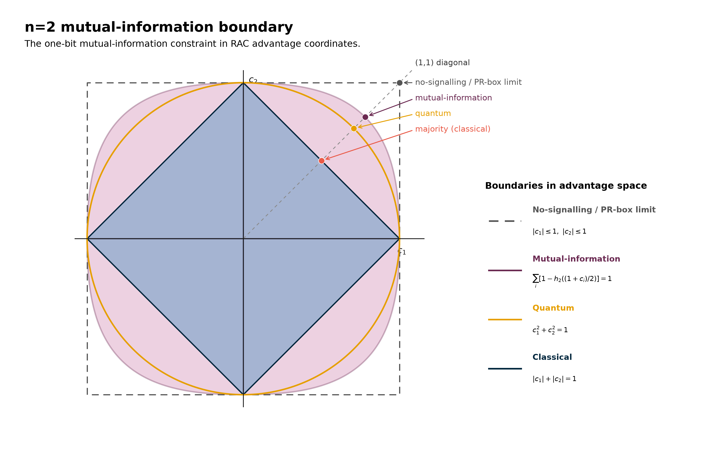
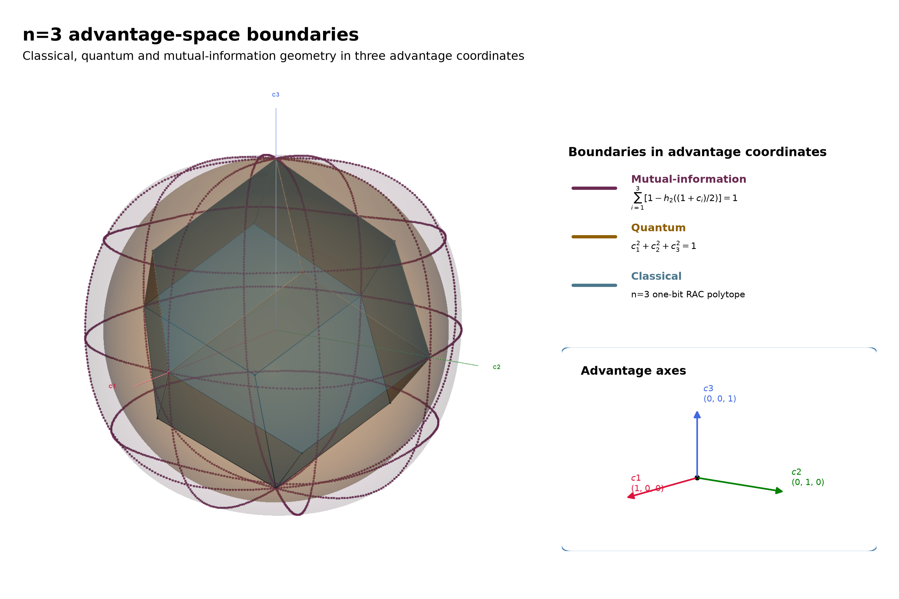
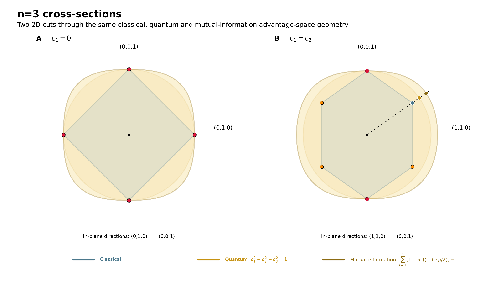

# Why Isn’t Nature More Quantum?

### *Stronger-than-quantum correlations can obey no-signalling. Information theory may explain why Nature still refuses to use them.*

Alice and Bob are playing a simple guessing game: QSeaBattle. Alice sees a board containing *n* bits and may send Bob one bit, while Bob is asked about one randomly chosen position. His job is simple: guess whether the bit at that position is 0 or 1. We discussed this game in previous posts and ended with a surprisingly simple result. The **classical strategy space** became more and more complicated as we increased the number of bits, but **quantum mechanics** did the opposite: it replaced that many-faced geometry with a sphere. For two bits we had a circle, for three a sphere, and in general a hypersphere,

*c₁*² + *c₂*² + ⋯ + *cₙ*² = 1.

It is a beautiful boundary. But this triggers the obvious question whether we can understand why Nature selected this limit.

Almost exactly a century ago, quantum mechanics arrived at this boundary from physics. Heisenberg's mechanics, Born's recognition of its matrix structure, and eventually Born's probabilistic interpretation of the wave function built the rules from which the quantum limit follows. Famously, the rule connecting amplitude to probability first appeared in Born's 1926 scattering paper as a correction added in proof: it was the square of the amplitude that mattered.

However, nothing in the geometry itself says that Nature has to stop at the quantum sphere. We can imagine a hypothetical resource ('post-quantum') that pushes Alice and Bob a little farther out, giving Bob a larger advantage for several possible questions at the same time. Push this all the way to the extreme and Bob could correctly retrieve whichever bit he is asked for.

For two bits, this extreme corresponds to the corners of a square in advantage space. At the corner *c₁* = *c₂* = 1, Bob could retrieve either of Alice's two bits perfectly, depending on which one he is asked for. Quantum mechanics does not come close to that corner — but, remarkably, correlations of this kind can still obey **no-signalling**. Alice cannot use them to send Bob an instantaneous message. So relativity, at least in this familiar no-faster-than-light sense, does not seem to explain why Nature stops at the quantum circle.

Perhaps we should therefore not ask what could exist beyond the quantum sphere, but why Nature selects the sphere in the first place.

> **Can an information-theoretical principle recover the quantum boundary?**

## The information boundary

Let's evaluate the game from an **information** perspective. For each possible question, Bob's advantage *cᵢ* corresponds to a success probability

*Pᵢ* = ½(1 + *cᵢ*).

From that probability we can calculate how much information Bob's answer carries about Alice's bit. For a uniformly random bit this is

*Iᵢ* = 1 − *h₂(Pᵢ*),

where *h₂* is the binary entropy.

Alice sends Bob only one classical bit. We can therefore ask whether the information associated with all his possible retrieval choices should also be limited to one bit. In terms of these individual mutual informations, that would mean

Σᵢ *Iᵢ* ≤ 1.

For now, let us simply draw the surface where the sum equals one. We will come back later to the physical principle behind it — and to what this sum actually means.

> *Figure 1: Classical, quantum, mutual-information and no-signalling boundaries for the two-bit guessing game. Classical one-bit strategies form the inner diamond, quantum strategies reach the circle, and the mutual-information boundary extends beyond the quantum circle in most directions. The dashed square marks the no-signalling / PR-box limit, where both retrieval advantages can in principle reach ±1.*
>
> Alt text: Two-dimensional RAC advantage-space diagram with four nested boundaries. A classical diamond lies inside the quantum circle. A larger rounded mutual-information boundary extends beyond the circle in most directions, while an outer dashed square marks the no-signalling / PR-box limit at |c₁| ≤ 1 and |c₂| ≤ 1. Along the positive diagonal, classical majority, quantum, mutual-information and PR-box-limit points are marked.

Figure 1 shows what happens for the smallest possible game, *n* = 2. The classical strategies form the familiar diamond, and the quantum strategies reach the circle around it. But the new mutual-information boundary sits farther out in most directions. Along the diagonal, for example, there is visible space between the quantum point and the point where the mutual-information sum reaches one bit.

And now we have a surprise. The quantum circle is not the largest region compatible with this information-theoretic condition. For two bits, the mutual-information boundary visibly extends beyond it.

So from information theory Alice and Bob could do slighltly better than allowed by quantum mechanics. If we wonder whether information theory can explain why Nature selects the quantum sphere, the answer is at least not hiding in this two-bit picture alone.

## As the game gets bigger

Perhaps the problem is simply that two bits are too few.

> *Figure 2: The same comparison in the full n = 3 advantage space. The classical strategies form a faceted polytope, the quantum boundary is a sphere, and the mutual-information condition defines a larger, distinctly non-spherical body.*
>
> Alt text: Three-dimensional RAC advantage-space rendering for n = 3. A faceted classical polytope sits inside a translucent quantum sphere, while a larger rounded mutual-information surface surrounds the quantum boundary in most directions. The three advantage axes c₁, c₂ and c₃ are shown.

The mutual-information condition does not depend on the size of Alice's board. We can apply exactly the same rule to three bits, four bits, or many more. The difficulty is that the geometry quickly escapes our ability to see it. With three bits we get one last chance to look at the full shape before moving into higher dimensions.

Figure 2 shows the three-dimensional advantage space, while Figure 3 show 2D cross sections. The quantum sphere appears as a circle in each cut, while the mutual-information boundary forms a different, somewhat larger curve around it. Just as for two bits, information theory still leaves room outside the quantum boundary.

> *Figure 3: Two cross-sections through the three-dimensional advantage space for n = 3. The classical polytope, quantum sphere and mutual-information boundary produce visibly different shapes. In particular, the mutual-information boundary leaves room beyond the quantum sphere at finite n.*
>
> Alt text: Two two-dimensional cross-sections through the n = 3 advantage space, comparing the classical polytope, the circular cross-section of the quantum sphere and the larger mutual-information boundary.

For four bits the full advantage space is already four-dimensional, so we can no longer draw it. But the cross-sections give us a way forward. We can take the same kind of two-dimensional cut through a higher-dimensional shape and compare what happens as the game grows.

There is one direction that is particularly interesting: the symmetric direction (1,1,…,1), where Bob has the same advantage for every possible question. We take a cross-section containing that direction and repeat it for n = 4, 8, 16 and 32.

The result is shown in Figure 3. At every finite size, there is still room between the quantum and mutual-information boundaries. But that room becomes increasingly restrictive as the game grows.

> *Figure 4: The information-theoretic constraint tightens as the guessing game grows. Equivalent cross-sections for n = 4, 8, 16 and 32 compare the quantum boundary with the mutual-information boundary along the symmetric (1,1,…,1) direction. At every finite n there is still room beyond the quantum boundary, but a fixed correlation even slightly stronger than the quantum limit will eventually cross the information-theoretic boundary as the game is scaled up.*
>
> Alt text: Four two-dimensional cross-sections through advantage spaces for n = 4, 8, 16 and 32. Each panel shows the circular quantum boundary and the mutual-information boundary, with the positive symmetric direction (1,1,…,1) marked. As n increases, the allowed region beyond the quantum boundary becomes increasingly restrictive, illustrating that any fixed correlation strength above the quantum limit eventually violates the mutual-information bound.

And this is where the picture becomes much more interesting than the two-bit case suggested.

Imagine a resource that is only *slightly* stronger than the strongest quantum one. Write its correlation strength as

*E* = 1/√2 + ε,

where ε can be as small as we like.

Alice and Bob can use copies of the same resource to construct progressively larger guessing games: two bits become four, four become eight, then sixteen, thirty-two, and so on. With each concatenation, the individual advantage becomes smaller. Nothing suddenly becomes perfect; in fact, Bob's guesses move progressively closer to chance.

Yet the information-theoretic constraint is tightening at the same time.

For **any** ε > 0, however small, there is eventually a game large enough that the resulting strategy crosses the mutual-information boundary. A tiny step beyond the quantum limit may survive at small *n*, but it cannot survive indefinitely as the game is scaled up.

> **Go even slightly beyond the quantum boundary, and eventually there is a guessing game large enough for information theory to object.**

That is a remarkable result. We started with an information boundary that seemed too generous: for two bits it visibly allowed correlations stronger than quantum mechanics. But when we demand that the same resource continue to work as Alice and Bob build larger and larger games, something special happens.

The value that survives is precisely the quantum one.

> **The value that survives is precisely the quantum one.**

## Why Isn’t Nature More Quantum?

We can now give a name to the idea behind the information boundary. In 2009, Marcin Pawłowski and colleagues proposed **Information Causality** [2]. Alice may hold any number of independent bits and send Bob only a limited classical message. Bob is then free to choose which bit he wants to guess. The principle says that the sum of the information available about all those possible choices cannot exceed the information Alice actually communicated.

For our game, where Alice sends one bit, this is the condition we have been drawing all along,

Σᵢ I(aᵢ : βᵢ) ≤ 1.

And we have just seen the remarkable consequence. At any fixed game size, Information Causality leaves some room outside the quantum sphere. But take any correlation strength even slightly beyond the quantum limit and keep using it to construct larger games: eventually it violates the information bound. The value that survives for arbitrarily large games is precisely

*E* = 1/√2.

This brings us back to where we started.

Almost a century ago, quantum mechanics reached this limit from physics. Heisenberg's new mechanics, Born's recognition of its matrix structure, and the probabilistic interpretation that followed became part of a mathematical framework of states, operators and probabilities. From that framework, the quantum limit follows.

We have taken a completely different road. We never assumed Hilbert space, quantum operators or the Born rule. We started with a guessing game and asked how much information one communicated bit should allow Bob to obtain.

**And we arrived at the same limiting correlation strength.**

That is what makes Information Causality so intriguing. Perhaps the quantum limit is not merely an unexplained consequence of the mathematical machinery of quantum mechanics. Perhaps there is an information-theoretic reason that Nature has to stop there.

But does that close the story? Maybe not completely.

The first thing to wonder is whether summing the information per index for Bob is correct. Bob never retrieves all *n* bits. He is asked for one bit, chooses the corresponding measurement, and obtains one answer. Had he been asked for another bit, he would have made another choice instead. Information Causality adds the mutual informations associated with all these alternative experiments. That is a perfectly well-defined mathematical quantity — but should we interpret it literally as the amount of information Bob *has*? Or is it better understood as the sum of what he *could have learned* under mutually exclusive choices?

There is also something curious about the limit in which the quantum boundary emerges. The sharp value *E* = 1/√2 is singled out as *n* becomes arbitrarily large. Yet in exactly that limit every individual advantage *cᵢ* approaches zero and Bob's success probability approaches 50%. We distinguish quantum mechanics from a slightly stronger theory by looking at more and more questions for which Bob becomes less and less able to predict the answer.

And our geometric pictures suggest one more question. Close to *cᵢ* = 0, binary mutual information is approximately quadratic in *cᵢ*. A sum of quadratic terms naturally produces something locally spherical. So how much of the sphere that emerges asymptotically is telling us something specifically about quantum mechanics, and how much is already built into the local shape of the information measure we chose?

None of this makes Information Causality less remarkable. Move even slightly beyond the quantum correlation strength and, somewhere in a sufficiently large guessing game, information theory objects. That is a surprisingly powerful result from a principle that does not start from quantum mechanics at all.

But it may not be the final answer to our question. Information Causality is one of several attempts to understand why Nature stops where it does. Communication-complexity arguments [3,4] and Macroscopic Locality [5], for example, approach the post-quantum world from different directions.

Perhaps information really is the fundamental principle hiding behind the quantum sphere. Or perhaps Information Causality is seeing the shadow of something deeper — a principle of geometry, consistency or symmetry that we have not yet identified.

So, after starting with a simple guessing game, we have arrived at a question that is still very much alive: **why isn't Nature more quantum?**

> **But does Information Causality explain the quantum boundary — or merely describe it from another direction?**

## References

[1] V. Scarani, “Feats, Features and Failures of the PR-box,” AIP Conference Proceedings 844, 309 (2006). https://doi.org/10.1063/1.2219371

[2] M. Pawłowski, T. Paterek, D. Kaszlikowski, V. Scarani, A. Winter and M. Żukowski, “Information Causality as a Physical Principle,” Nature 461, 1101–1104 (2009). https://doi.org/10.1038/nature08400

[3] W. van Dam, “Implausible Consequences of Superstrong Nonlocality,” Natural Computing 12, 9–12 (2013); originally arXiv/0501159 (2005).

[4] G. Brassard, H. Buhrman, N. Linden, A. A. Méthot, A. Tapp and F. Unger, “Limit on Nonlocality in Any World in Which Communication Complexity Is Not Trivial,” Physical Review Letters 96, 250401 (2006). https://doi.org/10.1103/PhysRevLett.96.250401

[5] M. Navascués and H. Wunderlich, “A Glance Beyond the Quantum Model,” Proceedings of the Royal Society A 466, 881–890 (201