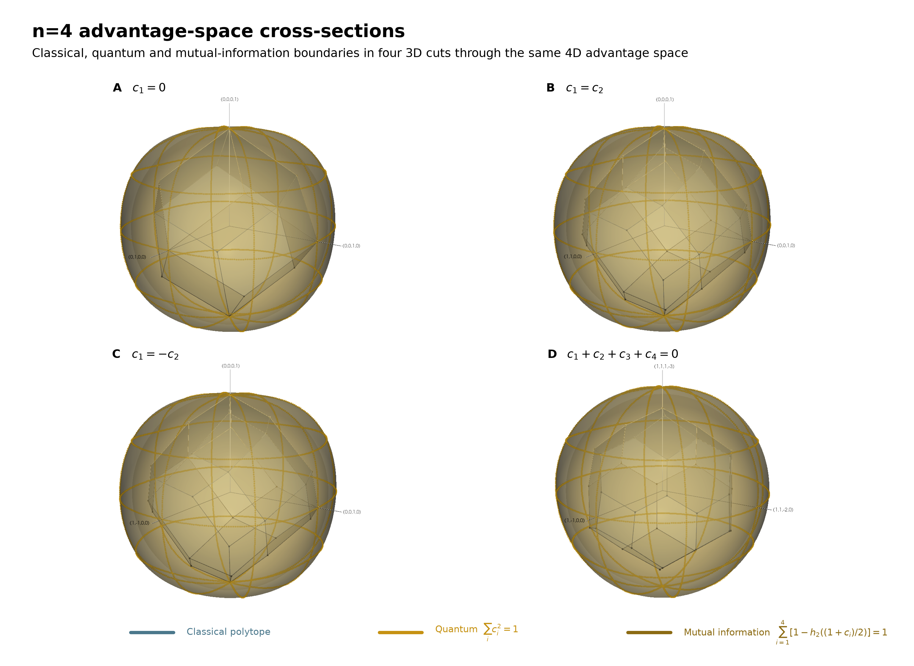

# Why Isn’t Nature More Quantum?

### *Stronger-than-quantum correlations can obey no-signalling. Information theory may explain why Nature still refuses to use them.*

Alice and Bob are playing a simple guessing game: QSeaBattle. Alice sees a board containing *n* bits and may send Bob one bit, while Bob is asked about one randomly chosen position. His job is simple: guess whether the bit at that position is 0 or 1. We discussed this game in previous posts and ended with a surprisingly simple result. The **classical strategy space** became more and more complicated as we increased the number of bits, but **quantum mechanics** did the opposite: it replaced that many-faced geometry with a sphere. For two bits we had a circle, for three a sphere, and in general a hypersphere,

*c₁*² + *c₂*² + ⋯ + *cₙ*² = 1.

It is a beautiful boundary. But this triggers the obvious question whether we can understand why Nature selected this limit.

Nothing in the geometry itself says that Nature has to stop at the quantum sphere. We can imagine a hypothetical resource that pushes Alice and Bob a little farther out, giving Bob a larger advantage for several possible questions at the same time. Push this all the way to the extreme and Bob could correctly retrieve whichever bit he is asked for.

For two bits, this extreme corresponds to the corners of a square in advantage space. At the corner *c₁* = *c₂* = 1, Bob could retrieve either of Alice's two bits perfectly, depending on which one he is asked for. Quantum mechanics does not come close to that corner — but, remarkably, correlations of this kind can still obey **no-signalling**. Alice cannot use them to send Bob an instantaneous message. So relativity, at least in this familiar no-faster-than-light sense, does not seem to explain why Nature stops at the quantum circle.

Perhaps we should therefore not ask what could exist beyond the quantum sphere, but why Nature selects the sphere in the first place.

> **Can an information-theoretical principle recover the quantum boundary?**

## A Different Boundary

There is another boundary we can draw. For each possible question, Bob's advantage *cᵢ* corresponds to a success probability

*Pᵢ* = ½(1 + *cᵢ*).

From that probability we can calculate how much information Bob's answer carries about Alice's bit. For a uniformly random bit this is

*Iᵢ* = 1 − *h₂(Pᵢ*),

where *h₂* is the binary entropy.

Alice sends Bob only one classical bit. We can therefore ask whether the information associated with all his possible retrieval choices should also be limited to one bit. In terms of these individual mutual informations, that would mean

Σᵢ *Iᵢ* ≤ 1.

For now, let us simply draw the surface where the sum equals one. We will come back later to the physical principle behind it — and to what this sum actually means.

> *Figure 1: Classical, quantum, mutual-information and no-signalling boundaries for the two-bit guessing game. Classical one-bit strategies form the inner diamond, quantum strategies reach the circle, and the mutual-information boundary extends beyond the quantum circle in most directions. The dashed square marks the no-signalling / PR-box limit, where both retrieval advantages can in principle reach ±1.*
>
> Alt text: Two-dimensional RAC advantage-space diagram with four nested boundaries. A classical diamond lies inside the quantum circle. A larger rounded mutual-information boundary extends beyond the circle in most directions, while an outer dashed square marks the no-signalling / PR-box limit at |c₁| ≤ 1 and |c₂| ≤ 1. Along the positive diagonal, classical majority, quantum, mutual-information and PR-box-limit points are marked.

Figure 1 shows what happens for the smallest possible game, *n* = 2. The classical strategies form the familiar diamond, and the quantum strategies reach the circle around it. But the new mutual-information boundary sits farther out in most directions. Along the diagonal, for example, there is visible space between the quantum point and the point where the mutual-information sum reaches one bit.

And now we have a surprise. The quantum circle is not the largest region compatible with this information-theoretic condition. For two bits, the mutual-information boundary visibly extends beyond it.

So if information theory is going to explain why Nature selects the quantum sphere, the answer cannot be hiding in this two-bit picture alone.

Figure 1 shows what happens for the smallest possible game, *n* = 2. The classical strategies form the familiar diamond, and the quantum strategies reach the circle around it. But the new mutual-information boundary sits farther out in most directions. Along the diagonal, for example, there is visible space between the quantum point and the point where the mutual-information sum reaches one bit.

### Three Dimensions: A New Boundary

> *Figure 2: Two cross-sections through the three-dimensional advantage space for n = 3. The classical polytope, quantum sphere and mutual-information boundary produce visibly different shapes. In both cuts, the mutual-information boundary leaves room beyond the quantum sphere at finite n.*
>
> Alt text: Two two-dimensional cross-sections through the n = 3 advantage space. The left panel shows the c₁ = 0 cut; the right panel shows c₁ = c₂. Each compares a faceted classical region with the circular cross-section of the quantum sphere and a larger rounded mutual-information boundary.

> *Figure 3: The same comparison in the full n = 3 advantage space. The classical strategies form a faceted polytope, the quantum boundary is a sphere, and the mutual-information condition defines a larger, distinctly non-spherical body.*
>
> Alt text: Three-dimensional RAC advantage-space rendering for n = 3. A faceted classical polytope sits inside a translucent quantum sphere, while a larger rounded mutual-information surface surrounds the quantum boundary in most directions. The three advantage axes c₁, c₂ and c₃ are shown.

### Four Dimensions in Slices

Go even slightly beyond the quantum boundary, and eventually there is a guessing game large enough for information theory to object.

> *Figure 4: Four three-dimensional cross-sections through the n = 4 advantage space. The classical boundary depends strongly on the direction of the cut, while the quantum hypersphere remains geometrically simple. The mutual-information boundary again extends beyond the quantum boundary at finite n.*
>
> Alt text: Four three-dimensional cross-sections through a four-dimensional RAC advantage space for n = 4. Each panel compares a faceted classical region with a spherical quantum cross-section and a larger rounded mutual-information boundary. The four slice directions produce visibly different classical shapes but the same simple quantum geometry.

### Why Isn’t Nature More Quantum?

But does Information Causality explain the quantum boundary — or merely describe it from another direction?

References

[1] V. Scarani, “Feats, Features and Failures of the PR-box,” AIP Conference Proceedings 844, 309 (2006). https://doi.org/10.1063/1.2219371

[2] M. Pawłowski, T. Paterek, D. Kaszlikowski, V. Scarani, A. Winter and M. Żukowski, “Information Causality as a Physical Principle,” Nature 461, 1101–1104 (2009). https://doi.org/10.1038/nature08400

[3] W. van Dam, “Implausible Consequences of Superstrong Nonlocality,” Natural Computing 12, 9–12 (2013); originally arXiv/0501159 (2005).

[4] G. Brassard, H. Buhrman, N. Linden, A. A. Méthot, A. Tapp and F. Unger, “Limit on Nonlocality in Any World in Which Communication Complexity Is Not Trivial,” Physical Review Letters 96, 250401 (2006). https://doi.org/10.1103/PhysRevLett.96.250401

[5] M. Navascués and H. Wunderlich, “A Glance Beyond the Quantum Model,” Proceedings of the Royal Society A 466, 881–890 (201